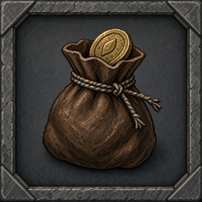

# JunkValue

JunkValue is a standalone LibDataBroker source that displays the vendor value of sellable gray items in bags 0–4. It shows a compact money total, and its tooltip shows the total and number of stacks. It never sells, picks up, or deletes items.

## Install

Copy the `JunkValue` folder into your Forever client's `Interface\AddOns` directory, so `JunkValue.toc` is at `Interface\AddOns\JunkValue\JunkValue.toc`. Restart or reload the client and enable JunkValue in the AddOns list.

## EllesmereUI DataBars

Open EllesmereUI's DataBars settings, choose the bar you want to configure, and set its block type to **Broker Plugin**. Select **Junk** (the source is named `JunkValue`) from the broker plugin list.

## Options

Right-click the broker block to toggle the EllesmereUI Junk Marker, a one-line merchant summary, or gold-only bar text when the total is over 1g. The same options are available with `/junkvalue marker`, `/junkvalue summary`, and `/junkvalue format`. Each option is off by default. The tooltip lists up to five highest-value junk stacks and gold earned from selling junk during the current session.

## Tests

Run `luajit tests/run.lua` from this folder.
